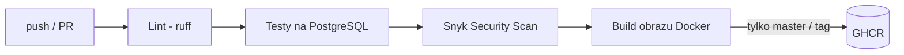

# WUDA-2026

Aplikacja ankiet (Django „polls”) przygotowana do uruchamiania w warunkach produkcyjnych.

## Etap 1 – CI/CD i Docker

### Co zmieniliśmy w aplikacji
| Było (narzędzia deweloperskie) | Jest (produkcja) |
|---|---|
| `manage.py runserver` | **Gunicorn** – produkcyjny serwer WSGI |
| SQLite | **PostgreSQL** (SQLite tylko jako fallback lokalny, gdy brak `POSTGRES_HOST`) |
| Pliki statyczne serwowane przez Django w trybie DEBUG | **WhiteNoise** + `collectstatic` w trakcie budowy obrazu |
| `SECRET_KEY` i `DEBUG=True` wpisane w kod | Konfiguracja przez **zmienne środowiskowe** (`DEBUG` domyślnie wyłączony) |
| Django 2.0 | Django 5.2 LTS (poprawione przestarzałe API w testach) |

### Potok CI/CD (GitHub Actions)

Obraz: `ghcr.io/mateusznowacki/wuda-2026` (tagi `latest`, `sha-<commit>`, `vX.Y.Z`).

### Uruchomienie lokalne
```bash
cp .env.example .env              # opcjonalnie, uzupełnij wartości
docker compose up -d --build      # aplikacja + PostgreSQL
# http://localhost:8000/polls/
docker compose exec web python manage.py createsuperuser
```

### Zmienne środowiskowe
| Zmienna | Opis |
|---|---|
| `DJANGO_SECRET_KEY` | Klucz kryptograficzny (wymagany gdy `DEBUG` wyłączony) |
| `DJANGO_DEBUG` | `true` tylko lokalnie, domyślnie `false` |
| `DJANGO_ALLOWED_HOSTS` | Lista domen oddzielona przecinkami |
| `DJANGO_CSRF_TRUSTED_ORIGINS` | Zaufane originy (np. `https://polls.example.com`) |
| `POSTGRES_HOST/PORT/DB/USER/PASSWORD` | Połączenie z bazą PostgreSQL |
| `GUNICORN_WORKERS` | Liczba procesów Gunicorna (domyślnie 2) |
| `DJANGO_RUN_MIGRATIONS` | `true` – migracje przy starcie kontenera |